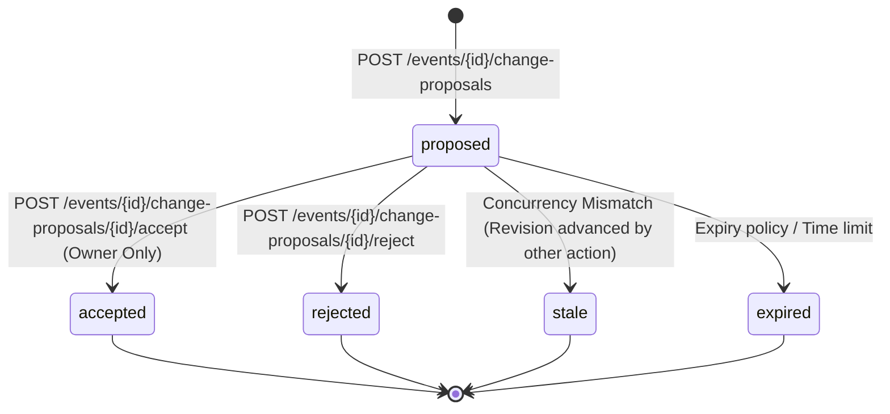

# Change Proposal Lifecycle & State Management

**Version:** 1.0.0  
**Date:** 1 November 2026  

---

## 1. State Machine



---

## 2. State Descriptions

| Status | Description | Permitted Next Actions |
|---|---|---|
| `proposed` | Initial proposal generated by editor or owner. Awaiting review. | Accept (owner only), Reject, Mark Stale |
| `accepted` | Terminal state. Approved by owner; mutations committed atomically. | None (Read-only) |
| `rejected` | Terminal state. Dismissed by host with optional reason. | None (Read-only) |
| `stale` | Terminal state. Superseded because another transaction bumped the event revision. | None (Host must generate fresh proposal) |
| `expired` | Terminal state. Proposal was unreviewed after expiration window. | None (Read-only) |

---

## 3. Concurrency Protection & Stale Invalidation

1. When a change proposal is accepted:
   - The accepted proposal moves to `accepted`.
   - `accepted_revision` is populated with the newly bumped event revision.
   - All other proposals for the same event with status `proposed` are atomically marked `stale` in the same transaction:
     ```sql
     update public.change_proposals
        set status = 'stale', updated_at = now()
      where event_id = %s and id != %s and status = 'proposed';
     ```
2. If an owner attempts to accept a proposal whose `base_revision` does not equal the locked event's current `revision`, the engine immediately marks the proposal `stale` and raises `ConflictError (409)`.
